# ClinicalTrials.gov query → visualization agent

A backend that takes a plain-English question about clinical trials and returns a
**chart specification** a frontend can render directly, built from live
[ClinicalTrials.gov API v2](https://clinicaltrials.gov/data-api/api) data, with
**every bar, point, node and edge traced back to the trial records behind it**.

```
POST /v1/visualize  {"query": "Show a network of sponsors and drugs for non-small cell lung cancer trials"}
→ network_graph: 60 nodes, 280 edges from all 8,679 NSCLC trials
  strongest edges: Eli Lilly ↔ pemetrexed (59 trials), Merck ↔ pembrolizumab (58), Eli Lilly ↔ cisplatin (45)
  each edge carries the NCT IDs and verbatim API text that put it there
```

**The core design rule:** the LLM only fills in a small, typed *query plan* (which
question type, which filters, which field to group by). It never produces a
number, a data row or a citation. Everything after the plan is deterministic,
tested Python over the fetched records.

- [Quickstart](#quickstart)
- [How it works](#how-it-works)
- [Request schema](#request-schema)
- [Response schema](#response-schema)
- [Supported questions](#supported-questions)
- [Avoiding hallucination](#avoiding-hallucination)
- [Planner evaluation](#planner-evaluation)
- [Design decisions and tradeoffs](#design-decisions-and-tradeoffs)
- [Handling real-world API data](#handling-real-world-api-data)
- [Example runs](#example-runs)
- [Testing](#testing)
- [Limitations and next steps](#limitations-and-next-steps)
- [AI tools used](#ai-tools-used)

---

## Quickstart

Requires Python 3.11+.

```bash
python3 -m venv .venv && source .venv/bin/activate
pip install -e ".[dev]"
cp .env.example .env          # add OPENAI_API_KEY (optional, see below)
uvicorn app.main:app --reload
```

Then open **http://localhost:8000/demo** for a small UI: type a question (or pick an
example), and click any bar, point, node, edge or row to see the trials behind it.

```bash
curl -s localhost:8000/v1/visualize -H 'content-type: application/json' \
  -d '{"query": "How has the number of trials for this drug changed per year since 2015?", "drug_name": "Pembrolizumab"}' | jq
```

| Endpoint | Purpose |
| --- | --- |
| `POST /v1/visualize` | Question in, visualization spec out |
| `GET /v1/schema` | The exact request and response JSON Schemas, for frontend engineers |
| `GET /health` | Liveness, and whether the LLM planner is configured |
| `GET /demo` | Demo UI that renders every chart type from the response spec, with click-through citations |
| `GET /docs` | Interactive OpenAPI docs (FastAPI) |

**Configuration** (`.env`, all optional):

| Variable | Default | Meaning |
| --- | --- | --- |
| `OPENAI_API_KEY` | empty | Enables the LLM planner. Without it, the rule-based planner is used and the service still works. |
| `PLANNER_MODEL` | `gpt-4.1-mini` | Model that fills the query plan (structured outputs, temperature 0) |
| `CTGOV_BASE_URL` | `https://clinicaltrials.gov/api/v2/studies` | Data source |
| `MAX_STUDIES` | `10000` | Cap on trials pulled per search |
| `CACHE_DIR` | `.cache` | On-disk cache of API pages |

Run the tests with `pytest -q` (504 tests, about 15 seconds, no network).
Regenerate the example outputs with `python scripts/run_examples.py`, and the
planner scores with `python scripts/eval_planners.py`.

---

## How it works

```mermaid
flowchart LR
    Q[Request] --> P["Planner<br/>(LLM or rules)"]
    P -->|QueryPlan| V[Validator + merge]
    V --> C[Compiler]
    C -->|API params| F["Client<br/>paging · cap · retry · cache"]
    F -->|raw studies| N[Normalizer]
    N -->|TrialRecords| O[Operator]
    O -->|rows + NCT IDs| B[Viz builder]
    B --> A[Citation attacher]
    A --> R[Response]
    style P stroke-dasharray: 5 5
```



Only the dashed step can involve an LLM.

| Stage | File | What it does |
| --- | --- | --- |
| Planner | `app/planner/llm_planner.py`, `rule_planner.py` | Question → `QueryPlan`. OpenAI structured outputs constrained to the plan's JSON Schema; keyword planner as fallback. |
| Validator | `app/planner/validator.py` | Re-validates the plan, one repair round-trip to the LLM, intent-specific checks, merges the request's structured fields (they always win, and each override is reported). |
| Compiler | `app/ctgov/compiler.py` | Plan → API parameters: `query.intr/cond/spons/locn`, `filter.overallStatus`, `filter.advanced` for phase and dates, and a `fields` projection of only the modules the question needs. |
| Client | `app/ctgov/client.py` | Async paging (1,000 per page), cap, exponential backoff on 429/5xx, disk cache keyed by the exact parameters. |
| Normalizer | `app/ctgov/normalize.py` | Raw study JSON → a flat `TrialRecord`, remembering the API path of every value for citations. |
| Operators | `app/analytics/operators.py` | `count`, `list_trials`, `count_by`, `time_series`, `compare`, `top_k`, `histogram`, `scatter`, `network`. Each returns rows **and** the set of NCT IDs behind each row. |
| Viz builder | `app/viz/builder.py` | A fixed table from question type to chart type, plus encodings, sort orders, units and a templated title. |
| Citations | `app/citations/attach.py` | Adds `citation_count` and up to 3 citations to every datum, quoting the API record verbatim. |
| Pipeline / API | `app/pipeline.py`, `app/main.py` | Wires the stages, times each one, assembles `meta` and `notes`. |
| Demo UI | `app/static/demo.html` | Renders any response: Vega-Lite for charts, d3 for networks, a click shows the citations. |

The contract all modules share (question types, dimensions, chart types, data
rules, verified API field paths) is written down in [`CLAUDE.md`](CLAUDE.md).

---

## Request schema

`POST /v1/visualize`, JSON body. Unknown fields are rejected with a 422, so a
typo like `"drug"` for `"drug_name"` fails loudly instead of silently doing nothing.

| Field | Type | Required | Validation | Meaning |
| --- | --- | --- | --- | --- |
| `query` | string | **yes** | 3–500 chars, trimmed | The question in plain English |
| `drug_name` | string | no | ≤ 200 chars | Intervention to filter on (`query.intr`) |
| `condition` | string | no | ≤ 200 chars | Disease or condition (`query.cond`) |
| `sponsor` | string | no | ≤ 200 chars | Lead sponsor or collaborator (`query.spons`) |
| `country` | string | no | ≤ 100 chars | Trial site location (`query.locn`) |
| `phase` | string[] | no | each one of `EARLY_PHASE1, PHASE1, PHASE2, PHASE3, PHASE4, NA` | Phase filter |
| `status` | string[] | no | each one of the API's 14 statuses, e.g. `RECRUITING`, `COMPLETED` | Overall status filter |
| `start_year` | int | no | 1990–2035 | Trials starting in or after this year |
| `end_year` | int | no | 1990–2035, ≥ `start_year` | Trials starting in or before this year |
| `compare_with` | string[] | no | ≤ 4 items | Other drugs to compare against `drug_name` |
| `viz_hint` | string | no | one of the 8 chart types | Preferred chart; honored only if it fits the result (a refused hint is explained in `notes`) |
| `max_studies` | int | no | 1–10,000; default = server cap | Most trials to pull per search |

Structured fields always override whatever the planner read from the question,
and each override is listed in `notes.overrides`.

```json
{ "query": "How has the number of trials for this drug changed over time?", "drug_name": "Pembrolizumab" }
```

---

## Response schema

Every response has the same three parts.

```jsonc
{
  "visualization": { "type": "...", "title": "...", "encoding": {...}, "data": ..., "options": {...} },
  "meta":  { ... how the answer was produced ... },
  "notes": { ... what the reader should know ... }
}
```

### `visualization`

`type` picks one of eight shapes. Each has its own required encoding channels,
enforced by the schema (a discriminated union on `type`), so a frontend can
switch on `type` and trust the fields it needs are present.

| `type` | Required channels | `data` shape | Typical question |
| --- | --- | --- | --- |
| `stat` | `y` | `[{trial_count}]` (one row) | "How many …?" |
| `table` | none; has a typed `columns` list | `[{nct_id, title, phase_label, status, sponsor, start_year}]` | "List …" |
| `bar_chart` | `x`, `y` | `[{<dimension>, trial_count}]` | Distribution across phases, sponsors, countries |
| `grouped_bar_chart` | `x`, `y`, `series` | `[{<dimension>, group, trial_count}]` | Drug A vs drug B by phase |
| `time_series` | `x`, `y` | `[{year, trial_count}]`, plus `series` when split | Trials per year |
| `histogram` | `x`, `y` | `[{bin_start, bin_end, count}]` | Distribution of enrollment |
| `scatter_plot` | `x`, `y` | `[{nct_id, <x>, <y>}]` (one point per trial) | Enrollment against duration |
| `network_graph` | `color`, `size` | `{nodes: [...], edges: [...]}` | Sponsor ↔ drug, drug ↔ drug |

**Encoding channel** (`x`, `y`, `series`, `color`, `size`, `label`): which data
key to read and how to draw it.

| Key | Type | Meaning |
| --- | --- | --- |
| `field` | string | Key in each data row (or node) |
| `type` | `nominal` \| `ordinal` \| `quantitative` \| `temporal` | Same vocabulary as Vega-Lite |
| `title` | string | Axis or legend label |
| `sort` | string \| string[] \| null | `"-trial_count"` for descending by count, or an explicit list (phases always come in clinical order) |
| `unit` | string \| null | `trials`, `participants`, `months` |
| `format` | string \| null | Number or date format hint |

**`options`** carries chart-specific rendering hints, e.g. `{"horizontal": true}`
for the country bar chart and `{"min_edge_weight": 2}` for networks.

**Network data:**

```jsonc
{
  "nodes": [{ "id": "drug:carboplatin", "label": "Carboplatin", "type": "drug", "weight": 764,
              "citation_count": 764, "citations": [ ... ] }],
  "edges": [{ "source": "sponsor:Eli Lilly and Company", "target": "drug:pemetrexed", "weight": 59,
              "citation_count": 59, "citations": [ ... ] }]
}
```

Node `weight` = trials the node appears in; edge `weight` = trials both ends
appear in together. Every edge endpoint is guaranteed to be a node id. Nodes of
two different kinds make a bipartite graph (sponsor ↔ drug); the same kind twice
makes a co-occurrence graph (drug ↔ drug within one trial).

### Citations (deep traceability)

Every datum (bar, time bucket, point, node, edge) carries:

- `citation_count`: how many trials contributed to it (always the true total)
- `citations`: up to 3 of them, most recent first

```json
{
  "nct_id": "NCT06607185",
  "title": "A Study of the Pan-KRAS Inhibitor LY4066434 in Participants With KRAS Mutant Solid Tumors",
  "field": "protocolSection.armsInterventionsModule.interventions[].name",
  "value": "Pemetrexed",
  "excerpt": "Pemetrexed",
  "url": "https://clinicaltrials.gov/study/NCT06607185"
}
```

`excerpt` and `title` are copied verbatim from the API record, never generated or
reworded, and `field` is the exact JSON path they came from. A test asserts that
every excerpt appears literally in the source study.

### `meta`

| Field | Meaning |
| --- | --- |
| `filters_applied` | The exact API parameters sent (one entry per group for comparisons) |
| `plan` | The validated QueryPlan, i.e. how the question was interpreted |
| `total_matched` | Trials matching the search, per the API |
| `studies_analyzed` | Trials actually downloaded and counted |
| `truncated` | `total_matched > studies_analyzed`; enforced by the schema so it can never disagree |
| `chart_recommended` | `false` for `stat` and `table`: a frontend can show a number or a list instead of a chart |
| `viz_rationale` | One line on why this chart type |
| `source` | `clinicaltrials.gov/api/v2` |
| `timings_ms` | Per stage: `plan`, `fetch`, `normalize`, `compute`, `build`, `cite` |

### `notes`

| Field | Meaning |
| --- | --- |
| `interpretation` | How the question was understood, in words |
| `assumptions` | Everything a reader needs to read the chart honestly: truncation, records left out for missing values, the "Not applicable" phase meaning, planner fallbacks, refused `viz_hint`s |
| `overrides` | Where a request field replaced what the planner read |

The full JSON Schemas are served at `GET /v1/schema`.

---

## Supported questions

| Question type | Example | Chart |
| --- | --- | --- |
| count | How many recruiting Alzheimer's trials are there? | `stat` |
| list | List recruiting phase 3 trials for pembrolizumab | `table` |
| distribution | How are breast cancer trials distributed across phases? | `bar_chart` |
| trend | How many trials started each year for asthma since 2015? | `time_series` |
| comparison | Compare phases for pembrolizumab vs nivolumab | `grouped_bar_chart` |
| geo | Which countries have the most recruiting diabetes trials? | `bar_chart` (horizontal) |
| network | Network of sponsors and drugs for NSCLC; drugs that co-occur with pembrolizumab | `network_graph` |
| histogram | Distribution of enrollment for Alzheimer's trials | `histogram` |
| correlation | Enrollment against duration for obesity trials | `scatter_plot` |

Any of these can be grouped by any of 12 dimensions: `phase`, `status`,
`start_year`, `sponsor`, `sponsor_class`, `country`, `intervention_type`, `drug`,
`condition`, `study_type`, `enrollment`, `duration_months`. New question types
are a new operator plus one row in the intent → chart table, with no special cases.

---

## Avoiding hallucination

1. **The LLM's output is only a plan.** The `QueryPlan` schema has nowhere to put
   a number, a row or a citation. `extra="forbid"` means an attempt to add an
   `answer` or `data` key is rejected, not carried along.
2. **Closed vocabularies.** Question types, dimensions, phases and statuses are
   enums. The model can't invent a field the data doesn't have.
3. **Structured outputs + re-validation.** OpenAI strict mode forces the reply
   into the plan's JSON Schema; the reply is then re-validated with the full
   Pydantic model, including the constraints strict mode can't express (lengths,
   ranges, numeric axes must be numeric dimensions).
4. **Repair, then fall back.** An invalid or incompatible plan gets one repair
   round-trip with the error message; if that fails, the deterministic rule
   planner runs and `notes` says so.
5. **User fields beat the model.** Explicit `drug_name`, `condition` etc. always
   override what the LLM extracted, and every override is reported.
6. **Chart type is a lookup, not a judgment.** Same plan, same chart, every time.
7. **Citations are quotes.** Copied from the API record and tested for verbatim
   presence on every fixture study and on live data (268 of 268 citations across
   6 live queries during development).
8. **Honest notes.** Truncation, dropped records and planner fallbacks are stated
   in `notes.assumptions` rather than hidden.

---

## Planner evaluation

`python scripts/eval_planners.py` scores both planners on 15 fixed questions
covering all nine intents, and writes
[`examples/planner_eval.md`](examples/planner_eval.md) and
[`planner_eval.json`](examples/planner_eval.json). It plans only — no
ClinicalTrials.gov calls — so it measures the planners and nothing downstream,
and the rule half runs offline in under a second.

| Planner | Intent correct | Checks passed | Exact plans |
| --- | --- | --- | --- |
| rule | 13/15 (87%) | 39/47 (83%) | 10/15 (67%) |
| LLM | needs `OPENAI_API_KEY`; reported as "not run" without one | | |

Each question is scored only on the plan fields its intent's operator actually
reads, plus the filters it asserts, and the operators' own defaults are
resolved first — an empty `group_by` on a distribution question *is* `phase`,
so a planner is not marked wrong for a field that cannot change the answer.
Expectations come from the contract in [`CLAUDE.md`](CLAUDE.md). The intent is
scored on its own because it alone decides the chart type.

What the rule planner misses, and the LLM planner is there for:

- **Intent from unusual phrasing.** "What is the total number of…" reads as a
  distribution, not a count; "Is enrollment related to study duration?" is not
  recognised as a correlation.
- **Dimensions that are implied, not named.** "industry versus government" is
  the `sponsor_class` dimension, but falls back to the default `phase`.
- **Entity boundaries.** It extracts `condition="look like for alzheimer's"`
  from "What does the distribution of enrollment look like for Alzheimer's
  trials?" — a search term that would match little. This is the keyword
  extraction being blunt, and it is why the fallback is flagged low confidence
  in `notes`.

It gets ten of the fifteen exactly right, which is what a fallback is for; the
numbers above are the honest size of the gap.

---

## Design decisions and tradeoffs

The full log, with the evidence for each, is in [`docs/decisions.md`](docs/decisions.md). The main ones:

| Decision | Why | Tradeoff |
| --- | --- | --- |
| LLM fills a typed plan; code computes everything | Removes the hallucination surface from numbers and data | A question the plan grammar can't express gets the closest supported reading (stated in notes), not a custom answer |
| One base spec class + 8 subclasses, discriminated on `type` | Per-chart required fields are enforced, the schema shows each shape exactly, and shared validation lives in one place | Row contents are plain dicts (so citations can be added), checked by operator tests rather than the schema |
| Always return a visualization; `stat` and `table` for questions that don't need a chart | Keeps one response shape for the frontend while answering "is a chart needed?" via `chart_recommended` | Two extra chart types to support |
| Fixed intent → chart table | Deterministic and testable | Less flexible than letting a model choose; `viz_hint` gives callers an escape hatch |
| Provenance tracked by every operator | Citations become a lookup, not a second pass | Slightly more bookkeeping in each operator |
| Rule-based planner fallback | Works with no API key or when the LLM fails | Lower accuracy on free-form phrasing, flagged "low confidence" in notes |
| Comparison = one search per side, fetched concurrently | The API can't tell which side a trial belongs to after a combined search | One more request per side |
| Cap of 10,000 trials, `fields` projection, disk cache | Most questions use every matching trial in a few seconds; repeats are instant | Very broad searches (e.g. all breast cancer, 17k) are capped, and notes say so |
| `gpt-4.1-mini`, temperature 0 | Supports strict structured outputs; picking from enums doesn't need a reasoning model | Swappable via `PLANNER_MODEL` |

---

## Handling real-world API data

These came from profiling real API responses (saved as test fixtures), not from
the docs.

| Observation | Handling |
| --- | --- |
| Observational studies have **no** `phases` key at all (9–21% of results) | Bucketed with `NA` as "Not applicable", and noted |
| Multi-phase trials (`PHASE1`+`PHASE2`, `PHASE2`+`PHASE3`) | Their own buckets, "Phase 1/2" and "Phase 2/3", so phase counts sum to the trial total; 8 buckets in clinical order |
| Partial dates like `2019-05` in up to 39% of results | Year taken from whatever is present; trials with no start date are counted and reported |
| Countries are full names ("France"), not ISO codes | Used verbatim, so citation excerpts stay exact |
| A trial runs in many countries | Counted once per distinct country (so country totals can exceed the trial count) |
| Any module can be missing (interventions, locations, enrollment) | The normalizer never assumes a key exists |
| "Drug" interventions include procedures, radiation, lab tests | Drug dimension uses only `DRUG`, `BIOLOGICAL`, `COMBINATION_PRODUCT` interventions |
| Drug names vary in case and carry doses ("Pembrolizumab 200 mg IV") | Grouped by a normalized key, labelled with the API's own spelling |
| The API rate-limits bursts (HTTP 429) | Exponential backoff, up to 6 attempts; a final failure is a clear 502 |
| Large result sets | Paging, a cap, and a `truncated` flag with "first N of M in API order; not a random sample" |
| Sparse networks | `min_edge_weight` keeps noise out; an empty graph comes with a note explaining why |

---

## Example runs

Real outputs from `python scripts/run_examples.py` against the live API, in [`examples/`](examples/):

| # | Question | Chart | Trials analysed |
| --- | --- | --- | --- |
| 01 | How has the number of trials for this drug changed per year since 2015? (`drug_name: Pembrolizumab`) | `time_series` | 2,942 of 2,942 |
| 02 | How are breast cancer trials distributed across phases? | `bar_chart` | 10,000 of 17,038 |
| 03 | Compare phases for trials involving pembrolizumab vs nivolumab | `grouped_bar_chart` | 5,053 of 5,053 |
| 04 | Which countries have the most recruiting trials for diabetes? | `bar_chart` | 1,975 of 1,975 |
| 05 | Show a network of sponsors and drugs for non-small cell lung cancer trials | `network_graph` | 8,679 of 8,679 |
| 06 | Which drugs frequently co-occur with pembrolizumab in combination studies? | `network_graph` | 3,008 of 3,008 |
| 07 | How many recruiting Alzheimer's disease trials are there? | `stat` | 625 of 625 |

What they show: pembrolizumab trials grew from 121 starts in 2015 to about 260 a
year; the NSCLC network's strongest links are Eli Lilly ↔ pemetrexed, Merck ↔
pembrolizumab and BMS ↔ nivolumab; pembrolizumab is most often combined with
carboplatin (274 trials), cisplatin and paclitaxel. Network files are large
(0.5–0.8 MB) because every node and edge carries citations.

---

## Testing

```bash
pytest -q        # 504 tests, ~15 s, no network
```

| Area | What's covered |
| --- | --- |
| Schemas | A valid example of every chart type; each missing channel rejected; edge endpoints must be nodes; `truncated` must match the counts; request validation |
| Plan | Catalog completeness; every intent; invalid plans rejected; the LLM-facing schema is closed |
| Normalizer | All 400 fixture studies; phase buckets, partial dates, missing modules, drug keys |
| Compiler / client | Exact parameters per plan; paging, cap, retry counts, no retry on 400, cache keys |
| Operators | Hand-checked totals per operator; networks (no self-loops, weights, caps); multi-valued counting |
| Citations | **Every excerpt appears verbatim in its raw source study** |
| Planners | Rule planner phrasing; validator merge, overrides, compatibility rules; LLM planner with a mocked client (valid, repaired, fallback) |
| Planner eval | The question set is well formed: all nine intents covered, every expectation names a field its intent actually reads, a missing plan still counts against the total |
| End to end | Request → response on fixtures; count uses the API total; comparisons fetch per side; zero matches; HTTP 200/422/502 |

Tests use four saved API responses (`tests/fixtures/`, 400 real studies) so
they're fast, offline and repeatable.

**How correctness was checked beyond unit tests:** live end-to-end runs of every
question type; citation excerpts re-checked against live records; counts compared
with the API's own `totalCount`; the example networks sanity-checked against
known sponsor–drug pairs (Merck ↔ pembrolizumab, BMS ↔ nivolumab).

---

## Limitations and next steps

- **Capped searches are the first N in API order, not a random sample.** Next
  step: for count-by-year and count-by-phase questions, ask the API for exact
  per-bucket totals (`countTotal` per bucket) instead of downloading records.
- **Drug synonyms.** The API's search expands synonyms (Keytruda → pembrolizumab),
  but network nodes are grouped by name, so "MK-3475" and "pembrolizumab" can
  appear as separate nodes. Next step: an alias map from the API's intervention
  synonyms.
- **The rule-based fallback is keyword based.** It reads unquoted drug and
  condition names with simple patterns and flags low confidence; the LLM planner
  handles free phrasing much better.
- **Future start dates.** Trend charts include the current year (partial) and
  planned future start dates; a frontend may want to shade those.
- **One comparison dimension.** Comparisons are drug vs drug (or condition vs
  condition) by one dimension; multi-dimension comparisons would need a richer plan.
- **The demo UI is deliberately thin.** `app/static/demo.html` is one file that
  maps the spec onto Vega-Lite (charts) and a d3 force layout (networks) and
  computes nothing itself, which is the point: it shows a frontend can render the
  spec without guessing. Libraries are vendored so it works offline.
- **The planner eval is 15 questions, scored on the plan only.** It says nothing
  about whether the numbers downstream are right (the test suite and the live
  runs cover that), and 15 questions is a sanity check, not a benchmark.

---

## AI tools used

- **Design and whiteboarding:** I used Claude to explore design ideas and
  whiteboard the architecture, and to lay out the pros and cons of each approach
  so I could choose between them: for example, letting the LLM pick the chart vs
  a fixed table, one schema class per chart vs a shared base, and how to handle
  capped result sets. The decisions and the evidence behind them are in
  [`docs/decisions.md`](docs/decisions.md).
- **Implementation:** Claude Code wrote most of the code in batches, working
  from a written contract (`CLAUDE.md`) that I kept updated as decisions changed.
- **Review:** after each batch I ran live end-to-end checks, which found real
  bugs that were then fixed: capped counts, non-drug interventions in drug
  networks, the fallback planner searching the whole registry, and API rate
  limiting.

**What I decided and designed myself:** the plan-only role of the LLM, the
QueryPlan grammar and dimension catalog, the request/response schemas, the
intent → chart table, the citation design and its verbatim test, the cap and
truncation policy, and the OpenAI switch. Each data rule came from profiling the
real fixtures rather than the docs.

**How I checked correctness:** the test suite above; live runs of every question
type; comparing counts with the API's `totalCount`; checking that citation
excerpts appear verbatim in live records; spot-checking cited NCT IDs on
clinicaltrials.gov.
